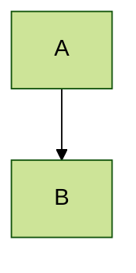
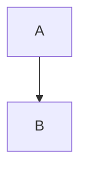
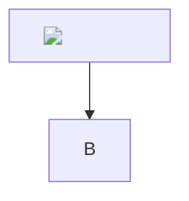

# `render-mermaid-svg-CkMiccpV.js` — полный разбор

**Размер:** 10 200 байт
**URL:** `https://web-sandbox.oaiusercontent.com/assets/render-mermaid-svg-CkMiccpV.js`
**Роль:** рендер Mermaid-диаграмм в SVG. Кастомный layout, healing
битого синтаксиса, изоляция рендера.

---

# ЧАСТЬ 1. Зависимости

## 1.1 `__vite__mapDeps`

```js
const __vite__mapDeps = (i, m = __vite__mapDeps, d = (m.f || (m.f = [
  "assets/render-X3XFXER2-qgBbUjf1.js",                 // [0] 1.45 МБ
  "assets/transform-4I4J0RKg.js",                       // [1] 37 КБ
  "assets/main-BR1bOQyH.js",                            // [2] 89 КБ
  "assets/main-foMHhJws.css",                           // [3] 510 Б
  "assets/mermaid.core-Dy3JtWEd.js"                     // [4] 460 КБ
]))) => i.map(i => d[i]);
```

| Индекс | Файл | Размер |
|---|---|---|
| 0 | `render-X3XFXER2-qgBbUjf1.js` | 1 454 844 |
| 1 | `transform-4I4J0RKg.js` | 37 571 |
| 2 | `main-BR1bOQyH.js` | 89 639 |
| 3 | `main-foMHhJws.css` | 510 |
| 4 | `mermaid.core-Dy3JtWEd.js` | 460 607 |

**`render-*.js` (1.45 МБ)** — внутри него **ELK layout engine**
(Java-порт, скомпилированный в JS).

**`mermaid.core` (460 КБ)** — сам Mermaid.

## 1.2 Импорт

```js
import {_ as I} from "./main-BR1bOQyH.js";
```

`I` = `_t()` — preload + динамический импорт.

---

# ЧАСТЬ 2. Layout-движки

## 2.1 Базовый

```js
var j = (t, n) => q(t, "name", {value: n, configurable: !0}),
    v = j(async () => await I(
          () => import("./render-X3XFXER2-qgBbUjf1.js"),
          __vite__mapDeps([0, 1, 2, 3])
        ), "loader"),

F = ["elk.stress", "elk.force", "elk.mrtree", "elk.sporeOverlap"],

G = [{name: "elk", loader: v, algorithm: "elk.layered"},
     ...F.map(t => ({name: t, loader: v, algorithm: t}))],

L = G;
```

**5 layout-движков:**

| Название | Алгоритм |
|---|---|
| `elk` | `elk.layered` |
| `elk.stress` | `elk.stress` |
| `elk.force` | `elk.force` |
| `elk.mrtree` | `elk.mrtree` |
| `elk.sporeOverlap` | `elk.sporeOverlap` |

**Все используют один загрузчик `v`** — тот же `render-X3XFXER2.js`.

**`j(...)`** — `defineProperty` для `name`. Функции присваивается имя
`"loader"` (для отладки).

**`L`** — алиас на `G`.

## 2.2 Что такое ELK

**Eclipse Layout Kernel** — библиотека раскладки графов. Портирована на JS
(`elkjs`). 1.45 МБ — это она.

**`elk.layered`** — иерархическая (слоистая) раскладка. Стандарт для
flowchart.

**Альтернативы:**
- `elk.stress` — минимизация напряжений (для больших графов)
- `elk.force` — силовая (пружины)
- `elk.mrtree` — дерево (для иерархий)
- `elk.sporeOverlap` — для перекрывающихся подграфов

---

# ЧАСТЬ 3. Кастомный layout `chatgpt-flowchart`

## 3.1 Обёртка

```js
const O = {
  ...L[0],                     // наследует {name: "elk", loader: v, algorithm: "elk.layered"}
  name: "chatgpt-flowchart",
  loader: async () => {
    const t = await L[0].loader();
    return {
      async render(n, o, e, s) { ... }
    }
  }
};
```

**Переопределяет `name` и `loader`.** Внутри — свой `render`.

## 3.2 Модификация узлов

```js
for (const r of n.nodes) {
  if (r.isGroup) continue;     // группы пропускаются

  // 1. diamond → rect + класс mermaid-decision
  (r.shape === "diamond" || r.shape === "diam"
   || r.shape === "decision" || r.shape === "question") &&
    (r.shape = "rect",
     r.cssClasses = `${r.cssClasses ?? ""} mermaid-decision`);

  // 2. прямоугольники → увеличенные
  (r.shape === "rect" || r.shape === "squareRect"
   || r.shape === "proc" || r.shape === "process"
   || r.shape === "rectangle" || r.shape === "rounded"
   || r.shape === "roundedRect" || r.shape === "event") &&
    (r.shape = "rect",
     r.padding = 16,
     r.labelPaddingX = 36,
     r.height = Math.max(r.height ?? 0, 60));
}
```

### Что изменяется

**1. Ромбы (`diamond`, `decision`, `question`) → прямоугольники**
с CSS-классом `mermaid-decision`.

**2. Все прямоугольные формы** приводятся к `rect` с:
- `padding: 16`
- `labelPaddingX: 36`
- `height ≥ 60`

**Формы, которые становятся `rect`:**
- `rect`, `squareRect`
- `proc`, `process`, `rectangle`
- `rounded`, `roundedRect`
- `event`

### Зачем

**Ромбы заменяются прямоугольниками, но визуально остаются ромбами**
через CSS:

```css
.node.mermaid-decision .label-container {
  fill: ${flowchartDecisionColor ?? edgeLabelBackground ?? "transparent"};
  stroke: ${flowchartLineColor ?? nodeBorder ?? "currentColor"};
  stroke-dasharray: 2 2;      /* ← пунктир */
}
```

**Это обход ограничения ELK:** ELK плохо работает с ромбами
(вычисление границ). Заменяя на `rect` + стилизация, получаем
**предсказуемую геометрию** с визуальным ромбом-пунктиром.

---

# ЧАСТЬ 4. Переопределения рендера

## 4.1 `labelHelper` — увеличение группы

```js
async labelHelper(r, d, ...l) {
  const i = await e.labelHelper(r, d, ...l);
  d.isGroup && (i.bbox = {
    ...i.bbox,
    width: i.bbox.width + 2 * Q,
    height: i.bbox.height + 2 * E
  });
  return i
}
```

**`Q = 24`, `E = 16`** — отступы.

**Для subgraph (группы)** — границы увеличиваются на `2×24` по ширине
и `2×16` по высоте. То есть padding внутри кластера = 24/16.

## 4.2 `insertEdge` — обрезка стрелок

```js
insertEdge(r, d, ...l) {
  const i = d.points ?? [],
        k = i.map(x => ({...x}));

  for (const [x, f, p] of [
    [0, 1, d.arrowTypeStart],
    [i.length - 1, i.length - 2, d.arrowTypeEnd]
  ]) {
    const _ = i[x], y = i[f];
    if (p !== "arrow_point" || _ == null || y == null) continue;

    const A = y.x - _.x,
          T = y.y - _.y,
          $ = Math.hypot(A, T);
    if ($ === 0) continue;

    const S = Math.min(8, Math.max(0, $ / 2 - 4));
    k[x] = {x: _.x + A / $ * S, y: _.y + T / $ * S}
  }

  return e.insertEdge(r, {...d, points: k}, ...l)
}
```

### Что делает

Для **первой** точки (start arrow) и **последней** (end arrow),
если тип `"arrow_point"` — сдвигает точку **вдоль линии** на расстояние
`S`.

**`S = min(8, max(0, length/2 - 4))`**

**Пример:**
- длина 100 → `S = min(8, 46) = 8` → сдвиг на 8
- длина 10 → `S = min(8, 1) = 1` → сдвиг на 1
- длина 6 → `S = min(8, -1→0) = 0` → без сдвига
- длина 0 → пропуск

**Зачем:** Mermaid рисует стрелку поверх линии, кончик покрывает текст
или выходит за узел. Сдвиг на 8 px — **визуальный зазор** между концом
линии и остриём.

**`k = i.map(x => ({...x}))`** — копия точек, чтобы не мутировать исходные.

## 4.3 `insertEdgeLabel` — подгонка фона метки

```js
async insertEdgeLabel(r, d) {
  const l = await e.insertEdgeLabel(r, d),
        i = l.querySelector("rect.background"),
        k = l.querySelector("text");

  if (d.label && i != null && k != null) {
    const f = k.getBBox(),
          p = Math.max(26, f.height + 8),
          _ = (p - f.height) / 2;

    i.setAttribute("x", String(f.x - 12));
    i.setAttribute("y", String(f.y - _));
    i.setAttribute("width", String(f.width + 24));
    i.setAttribute("height", String(p));
    i.style.removeProperty("stroke");

    const y = l.getBBox();
    d.width = y.width;
    d.height = y.height;
    l.parentElement?.setAttribute(
      "transform",
      `translate(${-y.x - y.width / 2},${-y.y - y.height / 2})`
    )
  }

  return l
}
```

### Что делает

**1. Высота фона** — `max(26, textHeight + 8)`.
- минимальная 26 px
- иначе текст + 8 px

**2. Позиция фона:**
- `x = text.x - 12` (отступ 12 влево)
- `y = text.y - (p - textHeight)/2` (центрирование)
- `width = text.width + 24` (12 с каждой стороны)
- `height = p`

**3. Убрать `stroke`** — фон без обводки.

**4. Центрирование группы** — `parentElement` сдвигается на
`translate(-y.x - w/2, -y.y - h/2)`.

**Зачем:** Mermaid рисует фон метки неточно, текст может вылезать.
Здесь подгонка «по месту».

---

# ЧАСТЬ 5. Постобработка SVG

## 5.1 Скругление кластеров

```js
o.selectAll(".cluster > rect").attr("rx", 16).attr("ry", 16);
```

**Все прямоугольники subgraph получают радиус 16.**

## 5.2 Кастомные маркеры стрелок

```js
const c = 4.5 / Math.SQRT2,     // ≈ 3.182
      a = 4 - c;                 // ≈ 0.818

o.selectAll('marker[id$="-pointEnd"], marker[id*="-pointEnd_"],
            marker[id$="-pointStart"], marker[id*="-pointStart_"]')
  .attr("viewBox", "-5 -5 10 10")
  .attr("markerWidth", 10)
  .attr("markerHeight", 10)
  .attr("refX", 0)
  .attr("refY", 0)
  .selectAll("path")
  .style("fill", "none")
  .style("stroke-width", "1")
  .style("stroke-dasharray", "none")
  .style("stroke-linecap", "round")
  .style("stroke-linejoin", "round");

o.selectAll('marker[id$="-pointEnd"] path, marker[id*="-pointEnd_"] path')
  .attr("d", `M 0 0 L 4 0 M ${a} ${-c} L 4 0 L ${a} ${c}`);

o.selectAll('marker[id$="-pointStart"] path, marker[id*="-pointStart_"] path')
  .attr("d", `M 0 0 L -4 0 M ${-a} ${-c} L -4 0 L ${-a} ${c}`);
```

### Разбор

**`viewBox="-5 -5 10 10"`** — 10×10, центр в 0.

**`refX=0, refY=0`** — опорная точка в центре.

### Форма `pointEnd` (стрелка вперёд)

```
M 0 0 L 4 0        — линия от центра до (4,0)
M 0.818 -3.182 L 4 0 L 0.818 3.182    — «галочка»
```

**`c = 4.5/√2 ≈ 3.182`** — вертикальный отступ.
**`a = 4 - c ≈ 0.818`** — горизонтальный.

**Итог:** открытая стрелка `—>`, где «галочка» начинается в
`(0.818, ±3.182)` и сходится в `(4, 0)`.

**Длина галочки:** `√((4-0.818)² + 3.182²) = √(10.1 + 10.1) ≈ 4.5`.

**То есть `c = 4.5/√2` рассчитано на длину галочки 4.5** под углом 45°.

### Форма `pointStart` (стрелка назад)

Зеркально: `M 0 0 L -4 0` и `M -0.818 ±3.182 L -4 0`.

### Что изменено от стандартного Mermaid

**Стандарт:** залитый треугольник.
**Здесь:** открытая «галочка» (`fill: none`).

**`stroke-linecap: round`** — скруглённые концы.
**`stroke-linejoin: round`** — скруглённые стыки.

**Визуальный стиль:** тонкие округлые стрелки, а не массивные
треугольники.

## 5.3 Подписи кластеров

```js
o.selectAll(".cluster-label").nodes().forEach(r => {
  const d = r.getAttribute("transform") ?? "";
  r.setAttribute("transform", `${d} translate(0, ${E})`)
});
```

**Все подписи subgraph сдвигаются вниз на 16 px** (`E = 16`).

**Зачем:** после увеличения границ группы (`labelHelper`) подпись
оказалась бы вплотную к верхней границе. Сдвиг вниз — визуальный отступ.

## 5.4 Маска — подписи без перекрытия

```js
const M = o.select(".edgePaths"),
      g = M.node(),
      h = g?.getCTM(),
      w = o.selectAll(".cluster-label").nodes();   // уже сдвинуты

if (g != null && h != null && w.length > 0) {
  const r = g.getBBox(),
        d = `${o.attr("id")}-subgraph-titles`,
        l = o.append("defs").append("mask")
          .attr("id", d)
          .attr("maskUnits", "userSpaceOnUse")
          .attr("x", r.x - E)
          .attr("y", r.y - E)
          .attr("width", r.width + 2 * E)
          .attr("height", r.height + 2 * E)
          .style("mask-type", "luminance");

  // 1. всё белое (видимо)
  l.append("rect")
    .attr("x", l.attr("x"))
    .attr("y", l.attr("y"))
    .attr("width", l.attr("width"))
    .attr("height", l.attr("height"))
    .attr("fill", "white");

  // 2. под метками — чёрные прямоугольники (скрыто)
  const i = h.inverse();
  for (const k of w) {
    const x = k.getCTM();
    if (x == null) continue;
    const f = k.getBBox(),
          p = i.multiply(x);      // матрица: из системы метки в систему edgePaths

    l.append("rect")
      .attr("x", f.x - 4)
      .attr("y", f.y - 4)
      .attr("width", f.width + 8)
      .attr("height", f.height + 8)
      .attr("transform", `matrix(${p.a},${p.b},${p.c},${p.d},${p.e},${p.f})`)
      .attr("fill", "black")
  }

  // 3. применить маску
  M.attr("mask", `url(#${d})`)
}
```

### Что это делает

**Маска на `.edgePaths`** — линиях связей.

**Белая область** — линии видны.
**Чёрные прямоугольники** под подписями subgraph — линии **скрыты**.

**Эффект:** когда линия проходит под заголовком группы, она
**обрезается** — заголовок читается без помех.

### Матрица преобразования

**`h = g.getCTM()`** — матрица текущего преобразования `.edgePaths`.

**`i = h.inverse()`** — обратная.

**`x = k.getCTM()`** — преобразование метки.

**`p = i.multiply(x)`** — из системы координат метки в систему `edgePaths`.

**Зачем:** маска в `userSpaceOnUse`, но прямоугольники в системе
метки. Нужно привести к одной системе.

**`mask-type: luminance`** — белое = видимо, чёрное = скрыто
(стандарт для SVG-масок).

**`-4` и `+8`** — отступ вокруг текста метки.

---

# ЧАСТЬ 6. Валидация источника

## 6.1 `W` — блоки `%%{...}%%`

```js
W = /%%\{[\s\S]*?\}%%/g
```

**Директивы Mermaid** в этом формате:
```
%%{init: {'theme':'dark'}}%%
flowchart TD
  A --> B
```

**`[\s\S]*?`** — нежадный, любой символ (включая переводы строк).

## 6.2 `U` — поиск `securityLevel`

```js
U = /securityLevel\s*:/i
```

**Регистронезависимо.**

**Блокируется:** любая попытка задать `securityLevel` в директивах.

**Сообщение:** `"Invalid Mermaid source"`.

**Почему:** `securityLevel: "loose"` отключает санитизацию Mermaid —
разрешает HTML в метках, клики по ссылкам, `javascript:`.

**См. `V()`:** `securityLevel: "strict"` устанавливается **жёстко**.

## 6.3 `Z` — flowchart/graph

```js
Z = /^[\t ]*(?:flowchart|graph)\b/i
```

**Проверка первой значимой строки.**

## 6.4 `D` — frontmatter

```js
D = /^---\s*[\n\r].*?[\n\r]---\s*[\n\r]+/s
```

**YAML-frontmatter:**
```
---
title: My Diagram
config:
  theme: dark
---
flowchart TD
```

**`s`-флаг** — `.` включает переводы строк.

## 6.5 `b()` — `sanitizeSource`

```js
function b(t) {
  const n = t.match(W) ?? [];

  for (const s of n)
    if (U.test(s))
      throw new Error("Invalid Mermaid source");

  const e = t.replace(W, "").trim();

  if (!e)
    throw new Error("Invalid Mermaid source");

  return e
}
```

### Логика

**1. Найти все `%%{...}%%`.**

**2. Если в любом есть `securityLevel:`** → throw.

**3. Удалить все `%%{...}%%`** → остаётся только диаграмма.

**4. Если после удаления пусто** → throw (значит был только блок директив).

### Что удаляется


→


**То есть ВСЕ директивы `%%{...}%%` выбрасываются**, не только
с `securityLevel`.

**Последствие:** нельзя настроить тему, кривые, шрифты через директивы.

**Компенсация:** тема передаётся через `themeVariables` из параметров.

## 6.6 `z()` — `isFlowchart`

```js
function z(t) {
  const n = t.replace(D, "");           // убрать frontmatter

  for (const o of n.split(/\r?\n/)) {
    const e = o.trim();
    if (!(!e || e.startsWith("%%"))) return Z.test(o)
  }

  return false
}
```

**Идёт по строкам, пропускает пустые и `%%`-комментарии.**
**Первая значимая строка** проверяется на `flowchart`/`graph`.

**`Z.test(o)`** — `o`, не `e`. То есть с оригинальным отступом.
`Z` учитывает `^[\t ]*`.

## 6.7 `nt()` / `ot()` — есть ли спецсимволы

```js
function nt(t) { return t.includes("(") || t.includes(")") || t.includes("|") }
function ot(t) { return t.includes("(") || t.includes(")") || t.includes("|") }
```

**Две одинаковые функции.** Опечатка/дублирование.

**Проверяет:** `(`, `)`, `|`.

**Зачем:** эти символы ломают Mermaid-парсер в метках без кавычек.

## 6.8 `H()` — кавычить проблемные метки

```js
function H({match: t, nodeId: n, rawLabel: o, open: e, close: s}) {
  if (!nt(o)) return t;                                    // нет спецсимволов

  const c = o.match(/^\s*/)?.[0] ?? "",                    // ведущие пробелы
        a = o.match(/\s*$/)?.[0] ?? "",                    // хвостовые пробелы
        M = o.slice(c.length, o.length - a.length);        // ядро

  if (!M || M.startsWith('"') && M.endsWith('"')) return t; // пустое или уже в кавычках

  const g = M.replace(/"/g, '\\"');                        // экранировать кавычки
  
  return `${n}${e}${c}"${g}"${a}${s}`
}
```

### Что делает

**Вход:** `A[Text (with) parens]`
**Выход:** `A["Text (with) parens"]`

**Сохранение пробелов:** ведущие/хвостовые пробелы вне кавычек.

**Экранирование:** `"` → `\"`.

**Пропуск:** если уже в кавычках — не трогать.

## 6.9 `Y` / `K` — regex узлов

```js
Y = /(\b[A-Za-z0-9_][A-Za-z0-9_.:-]*)\[([^\]\n]*)\]/g,      // A[text]
K = /(\b[A-Za-z0-9_][A-Za-z0-9_.:-]*)\{([^}\n]*)\}/g        // A{text}
```

**`Y`** — квадратные скобки (прямоугольник).
**`K`** — фигурные (ромб/решение).

**ID:** `[A-Za-z0-9_]` + `[A-Za-z0-9_.:-]*` — буквы, цифры, `_`, `.`, `:`, `-`.

**Содержимое:** `[^\]\n]*` — всё кроме `]` и перевода строки.

## 6.10 `rt()` / `et()` — применить `H`

```js
function rt(t) {
  return t.replace(Y, (n, o, e) => H({match: n, nodeId: o, rawLabel: e, open: "[", close: "]"}))
}
function et(t) {
  return t.replace(K, (n, o, e) => H({match: n, nodeId: o, rawLabel: e, open: "{", close: "}"}))
}
```

**`rt`** — квадратные скобки.
**`et`** — фигурные.

**`String.replace(regex, (match, group1, group2) => ...)`** — колбэк
получает: весь матч, `nodeId`, `rawLabel`.

## 6.11 `it()` — полное лечение

```js
function it(t) {
  if (!z(t) || !ot(t)) return t;                 // не flowchart или нет спецсимволов

  const n = t.match(D)?.[0] ?? "";                // frontmatter

  return n + et(rt(t.slice(n.length)))
}
```

**Три условия:**
1. `z(t)` — это flowchart
2. `ot(t)` — есть `(`, `)` или `|`
3. Иначе — вернуть как есть

**Frontmatter сохраняется**, тело обрабатывается `rt` + `et`.

**Порядок:** сначала `rt` (квадратные), потом `et` (фигурные).

**Проблема:** если в результате `rt` появились фигурные скобки из текста?..
`rt` только кавычит, не добавляет `{}`. Ок.

---

# ЧАСТЬ 7. Sandbox для рендера

## 7.1 `C = 2048`

```js
const C = 2048;
```

**Размер скрытого контейнера:** 2048×2048 px.

## 7.2 `ct()` — создание контейнера

```js
let u = null;

function ct() {
  if (u?.isConnected) return u;

  const t = document.body ?? document.documentElement;
  if (t == null) throw new Error("Mermaid sandbox renderer could not find a mount point.");

  return u = document.createElement("div"),
    u.setAttribute("aria-hidden", "true"),
    u.style.position = "fixed",
    u.style.top = "0",
    u.style.left = `-${C}px`,          // ← за экраном
    u.style.width = `${C}px`,
    u.style.height = `${C}px`,
    u.style.opacity = "0",
    u.style.pointerEvents = "none",
    u.style.overflow = "hidden",
    u.style.visibility = "hidden",
    t.appendChild(u),
    u
}
```

### Свойства

| Свойство | Значение | Зачем |
|---|---|---|
| `aria-hidden` | `"true"` | невидим для скринридеров |
| `position` | `fixed` | не влияет на поток |
| `top`, `left` | `0`, `-2048px` | **за левым краем экрана** |
| `width`, `height` | `2048px` | максимум места для рендера |
| `opacity` | `"0"` | невидим |
| `pointer-events` | `"none"` | не перехватывает клики |
| `overflow` | `"hidden"` | не растягивает страницу |
| `visibility` | `"hidden"` | не рендерится (экономия) |

**Семь уровней сокрытия.** Это важно: Mermaid рисует SVG с
реальными размерами, но контейнер невидим.

### Почему 2048

**Ограничение SVG-рендера:** если диаграмма больше контейнера —
обрежется. 2048×2048 — запас.

**Но:** очень большая диаграмма всё равно обрежется.

### Проблема `visibility: hidden`

**`getBBox()` на `visibility: hidden` элементах** может вернуть нули
в некоторых браузерах.

**Но:** Mermaid рендерит **внутри** этого контейнера, и `getBBox`
у `.edgePaths` работает — значит либо браузер всё равно считает
layout, либо `getBBox` на `visibility: hidden` работает (по спецификации —
да, `getBBox` не зависит от видимости).

### Один контейнер на всё

```js
if (u?.isConnected) return u;
```

**Глобальный `u`** — переиспользуется. Если `document.body` заменили —
`isConnected` = `false` → создаётся новый (старый остаётся висеть? нет,
старый в старом body).

---

# ЧАСТЬ 8. Инициализация Mermaid

## 8.1 `m()` — загрузка

```js
async function m() {
  const {default: t} = await I(
    async () => {
      const {default: n} = await import("./mermaid.core-Dy3JtWEd.js").then(o => o.bq);
      return {default: n}
    },
    __vite__mapDeps([4, 2, 3, 1])
  );
  return t.registerLayoutLoaders([...L, O]), t
}
```

**`import("./mermaid.core").then(o => o.bq)`** — берётся экспорт `bq`.

**`t.registerLayoutLoaders([...L, O])`** — регистрирует 5 ELK +
кастомный `chatgpt-flowchart`.

**`t`** — Mermaid-инстанс.

## 8.2 `J()` — кэш

```js
let B = null;
function J() { return B ?? (B = m()), B }
```

**Один промис.** Если упал — кэш отравлен (как в `hWe`).

## 8.3 `V()` — конфигурация

```js
function V({theme: t, themeVariables: n, isDarkMode: o, useElkLayout: e,
            hasImprovedFlowchartTheme: s}) {
  return {
    startOnLoad: !1,
    securityLevel: "strict",                   // ← ЖЁСТКО
    suppressErrorRendering: !0,
    theme: t,
    ...n == null ? {} : {themeVariables: n},
    ...e ? {layout: s ? O.name : "elk"} : {},
    themeCSS: `${s ? X(n) : ""}\n.node { color-scheme: ${o ? "dark" : "light"}; }`,
    darkMode: o,
    ...n?.fontFamily == null ? {} : {fontFamily: n.fontFamily},
    htmlLabels: !1,
    flowchart: {useMaxWidth: !1, htmlLabels: !1},
    sequence: {useMaxWidth: !1},
    gantt: {useMaxWidth: !1},
    journey: {useMaxWidth: !1},
    class: {useMaxWidth: !1},
    state: {useMaxWidth: !1},
    er: {useMaxWidth: !1},
    pie: {useMaxWidth: !1},
    quadrantChart: {useMaxWidth: !1},
    xyChart: {useMaxWidth: !1},
    requirement: {useMaxWidth: !1},
    mindmap: {useMaxWidth: !1},
    kanban: {useMaxWidth: !1},
    timeline: {useMaxWidth: !1},
    gitGraph: {useMaxWidth: !1},
    c4: {useMaxWidth: !1},
    sankey: {useMaxWidth: !1},
    block: {useMaxWidth: !1},
    packet: {useMaxWidth: !1},
    architecture: {useMaxWidth: !1},
    radar: {useMaxWidth: !1}
  }
}
```

### Ключевые настройки

| Параметр | Значение | Что |
|---|---|---|
| `startOnLoad` | `false` | не рендерить автоматически при загрузке |
| **`securityLevel`** | **`"strict"`** | жёсткая санитизация |
| `suppressErrorRendering` | `true` | не рисовать «ошибку» в SVG |
| `layout` | `"chatgpt-flowchart"` или `"elk"` | ELK-движок |
| `htmlLabels` | `false` | **метки в SVG `<text>`, не HTML** |
| **`useMaxWidth`** | **`false` везде** | не растягивать до контейнера |

### `securityLevel: "strict"`

**Три уровня Mermaid:**
- `"strict"` — всё HTML удаляется, ссылки не работают
- `"loose"` — HTML разрешён, `javascript:` блокируется
- `"antiscript"` — HTML разрешён, скрипты нет

**`"strict"` — максимальный.** Метки становятся plain text.

**Это блокирует XSS через Mermaid.**

### `htmlLabels: false` — критично

**С `htmlLabels: true`** Mermaid вставляет `<foreignObject><div>HTML</div></foreignObject>`.
Тогда HTML-инъекция возможна.

**С `false`** — только SVG `<text>`/`<tspan>`. Текст экранируется.

**Двойная защита:** `securityLevel: "strict"` + `htmlLabels: false`.

### `useMaxWidth: false` везде

**22 диаграммы** перечислены с `useMaxWidth: false`.

**Что это даёт:** SVG получает **естественный размер**, не `width: 100%`.
Значит диаграмма не растягивается и не сжимается — рендерится в
реальном масштабе.

**Зачем:** для `measureHeight` (виджет измеряет высоту) и для чёткости.

### `themeCSS` — кастомные стили

```js
themeCSS: `${s ? X(n) : ""}\n.node { color-scheme: ${o ? "dark" : "light"}; }`
```

**`s` = `hasImprovedFlowchartTheme`** → применить `X(n)` (большой CSS
из начала файла).

**`color-scheme`** — для нативных элементов (скроллбары и т.п.).

## 8.4 `X()` — CSS-тема (разбор)

```js
function X(t) {
  return `
.node text {
  font-size: 16px;
  font-weight: 600;
  letter-spacing: -0.32px;
  fill: ${t?.flowchartTextColor ?? t?.nodeTextColor ?? "currentColor"};
}
.edgeLabels text {
  font-size: 13px;
  font-weight: 600;
  letter-spacing: -0.08px;
  fill: ${t?.flowchartTextColor ?? t?.nodeTextColor ?? "currentColor"};
}
.node tspan[font-weight="normal"],
.edgeLabels tspan[font-weight="normal"] {
  font-weight: 600;
}
.edgeLabel .label rect {
  opacity: 1;
  rx: 13px;
  ry: 13px;
  fill: ${t?.flowchartEdgeLabelColor ?? t?.edgeLabelBackground ?? "transparent"};
  stroke: ${t?.flowchartEdgeLabelBorderColor ?? t?.nodeBorder ?? "currentColor"};
  stroke-width: 1px;
}
.node rect, .node circle, .node ellipse, .node polygon, .node path {
  fill: ${t?.flowchartNodeColor ?? t?.mainBkg ?? "transparent"};
  stroke: ${t?.flowchartNodeBorderColor ?? t?.nodeBorder ?? "currentColor"};
  stroke-width: 1px;
}
.node rect {
  rx: 16px;
  ry: 16px;
}
.node.mermaid-decision .label-container {
  fill: ${t?.flowchartDecisionColor ?? t?.edgeLabelBackground ?? "transparent"};
  stroke: ${t?.flowchartLineColor ?? t?.nodeBorder ?? "currentColor"};
  stroke-dasharray: 2 2;
}
.edgePaths .flowchart-link {
  stroke: ${t?.flowchartLineColor ?? t?.lineColor ?? "currentColor"};
  stroke-width: 1px;
  stroke-linecap: round;
  stroke-linejoin: round;
}
.marker {
  fill: ${t?.flowchartLineColor ?? t?.lineColor ?? "currentColor"};
  stroke: ${t?.flowchartLineColor ?? t?.lineColor ?? "currentColor"};
}
`
}
```

### Кастомные переменные темы

| Переменная | Что стилизует |
|---|---|
| `flowchartTextColor` | текст узлов |
| `flowchartNodeColor` | фон узлов |
| `flowchartNodeBorderColor` | граница узлов |
| `flowchartLineColor` | линии и стрелки |
| `flowchartDecisionColor` | фон решения (ромба) |
| `flowchartEdgeLabelColor` | фон метки связи |
| `flowchartEdgeLabelBorderColor` | граница метки связи |

**Fallback на стандартные Mermaid-переменные:** `nodeTextColor`,
`nodeBorder`, `mainBkg`, `lineColor`, `edgeLabelBackground`.

**Финальный fallback:** `currentColor` / `transparent`.

### Стили

**Текст:** 16px, weight 600, letter-spacing -0.32px.
**Метки связей:** 13px, weight 600, letter-spacing -0.08px.

**`tspan[font-weight="normal"] → 600`** — принудительно жирный даже для
«обычного» текста.

**Скругления:** узлы `rx: 16`, метки связей `rx: 13`.

**Ромб (`mermaid-decision`):** `stroke-dasharray: 2 2` — пунктир.

**Линии:** 1px, `round` концы и стыки.

---

# ЧАСТЬ 9. Рендер

## 9.1 `dt()` — инициализация с кэшем

```js
let P = null;

async function dt({theme: t, themeVariables: n, isDarkMode: o,
                   useElkLayout: e, hasImprovedFlowchartTheme: s}) {
  const c = await J(),
        a = JSON.stringify({theme: t, themeVariables: n, isDarkMode: o,
                            useElkLayout: e, hasImprovedFlowchartTheme: s});

  return P !== a && (c.initialize(V({...})), P = a), c
}
```

**Кэш по JSON-строке параметров.** Если параметры не изменились —
не переинициализировать.

**`P`** — глобальная строка.

**Проблема:** `JSON.stringify` с объектом `themeVariables` — порядок ключей
влияет на строку. Два одинаковых по смыслу объекта с разным порядком
дадут разные ключи → лишняя инициализация.

## 9.2 `N()` — рендер в sandbox

```js
async function N({mermaid: t, diagramId: n, source: o}) {
  const e = ct();                 // контейнер 2048×2048
    
  e.innerHTML = "";
  const s = await t.render(n, o),
        c = tt(s);
  e.innerHTML = "";
  return c
}
```

**1. `ct()`** — получить/создать контейнер.

**2. `e.innerHTML = ""`** — очистить перед рендером.
**3. `t.render(n, o)`** — Mermaid рендерит в контейнер, возвращает `{svg}`.
**4. `tt(s)`** — извлечь строку SVG.
**5. `e.innerHTML = ""`** — очистить после.

**Итог:** возвращается **строка SVG**, контейнер пуст.

**Проблема:** Mermaid `render()` возвращает `{svg, bindFunctions}`. Здесь
`bindFunctions` теряется — **интерактивность не работает** (клики по
узлам, тултипы).

## 9.3 `tt()` — извлечь SVG

```js
function tt(t) {
  let n;
  if (typeof t == "string") n = t;
  else if (t != null && typeof t == "object") n = t.svg;
  if (!n) throw new Error("Invalid Mermaid SVG output");
  return n
}
```

**Поддержка двух форматов:** строка или `{svg}`.

## 9.4 `st()` — главный рендер с healing

```js
async function st({source: t, theme: n, themeVariables: o,
                   isDarkMode: e, diagramId: s}) {
  const c = b(t),                                  // 1. sanitize
        a = o != null,                             // 2. есть themeVariables
        M = a && z(c),                             // 3. flowchart с темой
        g = await dt({theme: n, themeVariables: o, isDarkMode: e,
                      useElkLayout: a, hasImprovedFlowchartTheme: M});

  try {
    return await N({mermaid: g, diagramId: s, source: c})   // 4. рендер
  } catch (h) {
    const w = it(c);                                        // 5. healing
    if (w === c) throw h;                                   // 6. не изменилось → ошибка

    try {
      return await N({mermaid: g, diagramId: `${s}-healed`, source: w})
    } catch { throw h }                                     // 7. healing не помог → исходная ошибка
  }
}
```

### Пошагово

**1. `b(t)`** — убрать `%%{...}%%`, проверить `securityLevel`.

**2. `a = o != null`** — есть `themeVariables`?

**3. `M = a && z(c)`** — есть тема **и** это flowchart → улучшенная тема.

**4. `dt(...)`** — Mermaid + конфиг.

**5. `N(...)`** — рендер.

**При ошибке:**

**6. `it(c)`** — попытка «лечения»: кавычить метки со спецсимволами.

**7. Если `w === c`** — лечение ничего не изменило → пробросить
исходную ошибку.

**8. `N({... source: w})`** — рендер исправленного, `diagramId: "${s}-healed"`.

**9. Если и это упало** — пробросить **исходную** ошибку `h`.

### Ключевая деталь

**Если healing сработал — `diagramId` меняется** на `${s}-healed`.

**Зачем:** Mermaid использует `id` для генерации уникальных ID
внутри SVG (`marker-${id}`, `mask-${id}`). При двух рендерах с тем же
id — коллизия стилей.

## 9.5 `lt()` — сериализация

```js
let R = Promise.resolve();

function lt(t) {
  const n = R.then(() => st(t));
  R = n.then(() => {}, () => {});     // ← не пробрасывать ошибку в цепь
  return n
}
```

### Что делает

**`R`** — глобальная цепь промисов.

**`R.then(() => st(t))`** — `st()` выполнится **после** предыдущего.

**`R = n.then(() => {}, () => {})`** — новая цепь резолвится **в любом
случае** (и при успехе, и при ошибке).

**Зачем:** сериализация. Mermaid не потокобезопасен (общий DOM-контейнер,
глобальный `P` с конфигом).

**`return n`** — вызывающий получает **оригинальный** промис
(с ошибкой, если она была).

**Проблема:** последовательная обработка. При многих диаграммах —
очередь. Но диаграмма рендерится быстро.

## 9.6 Экспорт

```js
const at = Object.freeze(Object.defineProperty({
  __proto__: null,
  renderMermaidSvg: lt
}, Symbol.toStringTag, {value: "Module"}));

export {j as _, at as r};
```

**Экспорты:** `_` = `j` (`defineProperty`-хелпер), `r` = модуль
с `renderMermaidSvg`.

---

# ЧАСТЬ 10. Полная схема

```
renderMermaidSvg({source, theme, themeVariables, isDarkMode, diagramId})
 │
 ├─ R = R.then(() => st(t))        ← сериализация
 │
 ├─ st()
 │   ├─ b(source)
 │   │    ├─ найти все %%{...}%%
 │   │    ├─ есть securityLevel: ? → throw "Invalid Mermaid source"
 │   │    ├─ удалить все %%{...}%%
 │   │    └─ пусто? → throw
 │   │
 │   ├─ a = themeVariables != null
 │   ├─ M = a && isFlowchart(source)
 │   │
 │   ├─ dt({theme, themeVariables, isDarkMode, useElkLayout: a, hasImproved: M})
 │   │    ├─ J() → loadMermaid()
 │   │    │    ├─ import mermaid.core → export bq
 │   │    │    └─ registerLayoutLoaders([elk×5, chatgpt-flowchart])
 │   │    ├─ JSON.stringify(params) !== P?
 │   │    ├─ mermaid.initialize(V({...}))
 │   │    │    ├─ securityLevel: "strict"
 │   │    │    ├─ htmlLabels: false
 │   │    │    ├─ useMaxWidth: false (×22)
 │   │    │    └─ themeCSS: X(themeVariables) + color-scheme
 │   │    └─ → mermaid instance
 │   │
 │   ├─ N({mermaid, diagramId, source})
 │   │    ├─ ct() → div 2048×2048, за экраном, hidden
 │   │    ├─ div.innerHTML = ""
 │   │    ├─ mermaid.render(diagramId, source)
 │   │    │    └─ chatgpt-flowchart.render()
 │   │    │         ├─ diamond → rect + .mermaid-decision
 │   │    │         ├─ rect/proc/event → rect, padding 16, h≥60
 │   │    │         ├─ labelHelper: группы +24/+16
 │   │    │         ├─ insertEdge: стрелки сдвиг до 8px
 │   │    │         ├─ insertEdgeLabel: фон max(26, h+8)
 │   │    │         ├─ .cluster > rect → rx/ry 16
 │   │    │         ├─ маркеры → открытые галочки
 │   │    │         ├─ .cluster-label → +16px вниз
 │   │    │         └─ маска на .edgePaths под подписями
 │   │    ├─ tt() → извлечь .svg
 │   │    └─ div.innerHTML = ""
 │   │
 │   └─ catch → it(source)
 │        ├─ if !isFlowchart || нет ( ) | → без изменений
 │        ├─ rt(): A[text] → A["text"]  (если есть ( ) |)
 │        ├─ et(): A{text} → A{"text"}  (если есть ( ) |)
 │        └─ frontmatter сохраняется
 │        └─ if изменилось → рендер с "${diagramId}-healed"
 │
 └─ → SVG-строка
```

---

# ЧАСТЬ 11. Слабые места

## 11.1 `bindFunctions` теряется

```js
const s = await t.render(n, o),
      c = tt(s);
```

**`t.render()` возвращает `{svg, bindFunctions}`.**

**`bindFunctions` не вызывается** → клики по узлам, тултипы, ссылки
**не работают**.

**С `securityLevel: "strict"` и `htmlLabels: false` — они всё равно
не работали бы.** Но это подтверждает: **диаграммы статические**.

## 11.2 `visibility: hidden` + `getBBox`

```js
u.style.visibility = "hidden";
```

**`getBBox()` на элементах внутри `visibility: hidden` контейнера**
работает (по спецификации SVG), но:

**`Element.getBoundingClientRect()`** вернёт нули.

**В коде используется `getBBox()`** — ок.

**Но `getCTM()`** может вести себя иначе в разных браузерах при
`visibility: hidden`.

## 11.3 Один контейнер — состояние между рендерами

```js
if (u?.isConnected) return u;
```

**Общий `u`.** Если рендер упал посередине — контейнер может содержать
мусор. Хотя `e.innerHTML = ""` очищает.

**Но `e.innerHTML = ""` дважды** (до и после) — если `t.render` бросит,
второй `innerHTML = ""` не выполнится (нет в `finally`).

**Утечка:** после ошибки контейнер остаётся с частичным SVG.

## 11.4 `J()` — кэш отравляется при ошибке

```js
function J() { return B ?? (B = m()), B }
```

**Если `m()` бросит** — `B` останется rejected-промисом навсегда.
Все последующие рендеры упадут мгновенно.

## 11.5 `P` — кэш конфига по `JSON.stringify`

```js
const a = JSON.stringify({theme: t, themeVariables: n, isDarkMode: o,
                          useElkLayout: e, hasImprovedFlowchartTheme: s});
return P !== a && (c.initialize(V({...})), P = a), c
```

**Порядок ключей** в `themeVariables` влияет на строку.

**Два объекта** `{a: 1, b: 2}` и `{b: 2, a: 1}` дадут разные строки →
лишняя `initialize()`.

## 11.6 `nt()` и `ot()` — дубликаты

```js
function nt(t) { return t.includes("(") || t.includes(")") || t.includes("|") }
function ot(t) { return t.includes("(") || t.includes(")") || t.includes("|") }
```

**Полностью идентичны.** Вероятно, копипаста.

## 11.7 `H()` не обрабатывает `[` в тексте

```js
Y = /(\b[A-Za-z0-9_][A-Za-z0-9_.:-]*)\[([^\]\n]*)\]/g
```

**`[^\]\n]*`** — текст не может содержать `]`.

**Пример:** `A[Array[0]]` — regex не сматчится (первый `]` оборвёт).

**То есть:** метки с `]` внутри не будут кавычены. Mermaid может
сломаться.

## 11.8 Healing не работает для `[[...]]`, `((...))`, `{{...}}`

**Regex `Y` и `K` обрабатывают только `[...]` и `{...}`.**

**Формы Mermaid:**
- `A[text]` — квадрат ✅
- `A(text)` — круг ❌
- `A((text))` — двойной круг ❌
- `A{text}` — ромб ✅
- `A{{text}}` — шестиугольник ❌
- `A>text]` — флаг ❌
- `A[/text/]` — параллелограмм ❌
- `A[\text\]` — трапеция ❌

**Большинство форм не лечится.**

## 11.9 Удаление всех `%%{...}%%`

```js
const e = t.replace(W, "").trim();
```

**Не только `securityLevel` — все директивы.**

**Пользователь не может задать:**
- `theme`
- `flowchart.curve`
- `fontFamily`
- `themeVariables`

**Компенсация:** через параметры `theme`/`themeVariables`.

## 11.10 `2048×2048` — обрезка больших диаграмм

**Если SVG больше 2048×2048** — обрежется.

**Диаграмма с 50+ узлами** легко превысит.

**`useMaxWidth: false`** не помогает — контейнер всё равно 2048.

## 11.11 `securityLevel: "strict"` — не абсолютная защита

**Известные обходы Mermaid `strict`:**
- `%%{init: {'securityLevel': 'loose'}}%%` — **блокируется** в `b()`
- frontmatter `config: {securityLevel: loose}` — **не проверяется!**

**Проверим `b()`:**
```js
const n = t.match(W) ?? [];      // только %%{...}%%
for (const s of n) if (U.test(s)) throw ...
```

**`D` (frontmatter) не проверяется на `securityLevel`.**

**Frontmatter:**


**`b()` не найдёт `securityLevel` в frontmatter** (только в `%%{}%%`).

**`V()` устанавливает `securityLevel: "strict"` глобально** — но
frontmatter-конфиг **переопределяет** глобальный в Mermaid.

**Плюс `htmlLabels: false`** — HTML-метки отключены → `` не
вставится как HTML.

**Но** `securityLevel: loose` + `htmlLabels: false` — метки в `<text>`,
HTML не работает. **Защита держится на `htmlLabels: false`.**

**Если `htmlLabels` где-то включён** — XSS.

**Проверить:** в `V()` `htmlLabels: !1` и `flowchart: {htmlLabels: !1}`.
Оба жёстко `false`. **Ок.**

**НО:** `themeCSS` из `themeVariables` — можно ли инжектить через
`themeVariables`? `X(n)` подставляет значения в CSS:
```js
fill: ${t?.flowchartTextColor ?? ...}
```

**Если `flowchartTextColor = "red; } body { display:none } .x {"`** — CSS-инъекция!

**`themeCSS` вставляется в `<style>` внутри SVG.**

**Проверить:** `themeVariables` приходит из параметров `renderMermaidSvg`.
Кто их передаёт? В Skybridge — хост (ChatGPT). Значит контроль у хоста,
не у пользователя.

**Но если модель генерирует `themeVariables`** — инъекция возможна.

## 11.12 `themeCSS` — инъекция через `themeVariables`

```js
fill: ${(t?.flowchartTextColor) ?? (t?.nodeTextColor) ?? "currentColor"};
```

**Значение подставляется в CSS без экранирования.**

**Payload:**
```js
themeVariables: {
  flowchartTextColor: "red } * { display: none } .x { fill: blue"
}
```

**Результат:**
```css
.node text {
  fill: red } * { display: none } .x { fill: blue;
}
```

**CSS-инъекция.** Что можно: спрятать элементы, наложить оверлей
(если позиционирование разрешено), подменить контент через `content:`.

**`content:` в SVG-контексте** — ограничен. Но `display:none` на любом
элементе — работает.

**Ограничение:** инъекция **внутри** `<style>` SVG. Не выходит за пределы
SVG. Значит максимальный эффект — визуальная подмена диаграммы.

**Всё равно:** если модель или пользователь контролирует
`themeVariables`, можно сломать отображение.

## 11.13 `R` — цепь промисов без ограничения

```js
function lt(t) {
  const n = R.then(() => st(t));
  R = n.then(() => {}, () => {});
  return n
}
```

**`R` растёт вечно** (каждый вызов добавляет `.then`). Технически —
цепочка промисов, память освобождается по мере выполнения.

**Но:** если `st()` зависнет — все последующие ждут.

## 11.14 `chatgpt-flowchart` — переопределяет только `render`

```js
return { async render(n, o, e, s) { ... } }
```

**Объект-загрузчик возвращает только `render`.** Если Mermaid ожидает
другие методы layout-плагина — их нет.

**`...L[0]`** — наследование от `elk`, но `loader` переопределён и
возвращает **новый объект** с одним `render`. Остальные свойства `elk`
потеряны.

---

# ЧАСТЬ 12. Итог

## 12.1 Ключевые числа

| Что | Значение |
|---|---|
| Размер файла | 10 200 байт |
| Зависимости | 1.45 МБ + 460 КБ + 37 КБ |
| Layout-движков | 5 ELK + 1 кастомный |
| Контейнер для рендера | 2048×2048 |
| Уровней сокрытия контейнера | 7 |
| Диаграмм в конфиге (`useMaxWidth: false`) | 22 |
| CSS-переменных темы | 7 кастомных + 5 fallback |
| Сдвиг стрелки (макс) | 8 px |
| Padding группы | 24 × 16 |
| Минимальная высота узла | 60 px |
| Минимальная высота метки | 26 px |
| Форм, лечимых healing | 2 из ~10 |

## 12.2 Главное

**1. `securityLevel: "strict"` + `htmlLabels: false` — двойная защита от XSS.**
Метки только в SVG `<text>`, HTML не вставляется.

**2. `b()` блокирует `securityLevel` только в `%%{...}%%`, не в frontmatter.**
```js
const n = t.match(W) ?? [];   // W = /%%\{[\s\S]*?\}%%/g — только директивы
```
**Frontmatter `config: {securityLevel: loose}` не проверяется.** Защита
держится на `htmlLabels: false`.

**3. `themeCSS` — CSS-инъекция через `themeVariables`.**
```js
fill: ${t?.flowchartTextColor ?? ...}
```
Значение без экранирования. `"red } * { display: none } .x {"` → инъекция
внутри `<style>` SVG.

**4. Удаляются ВСЕ `%%{...}%%`, не только `securityLevel`.**
Нельзя настроить тему/кривые/шрифты через директивы.

**5. `chatgpt-flowchart` — кастомный ELK-layout.**
- `diamond` → `rect` + `.mermaid-decision` (пунктир)
- `rect/proc/event` → `rect` + `padding 16` + `h ≥ 60`
- стрелки сдвигаются до 8 px
- метки связей: фон `max(26, текст+8)`
- маска на линиях под подписями subgraph

**6. Healing лечит только `[...]` и `{...}`.**
`(...)`, `((...))`, `{{...}}`, `>...]`, `[/.../]`, `[\...\]` — не лечатся.

**7. `bindFunctions` теряется — диаграммы статические.**

**8. `J()` и `P` — кэши. `J()` отравляется при ошибке, `P` дублирует
инициализацию при перестановке ключей.**

**9. `2048×2048` — большие диаграммы обрезаются.**

**10. `R` — сериализация рендеров (Mermaid не потокобезопасен).**
